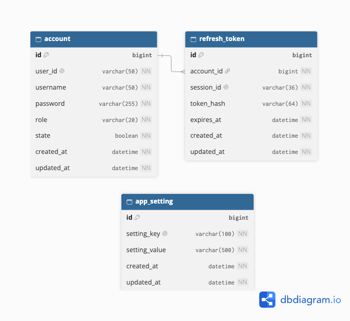
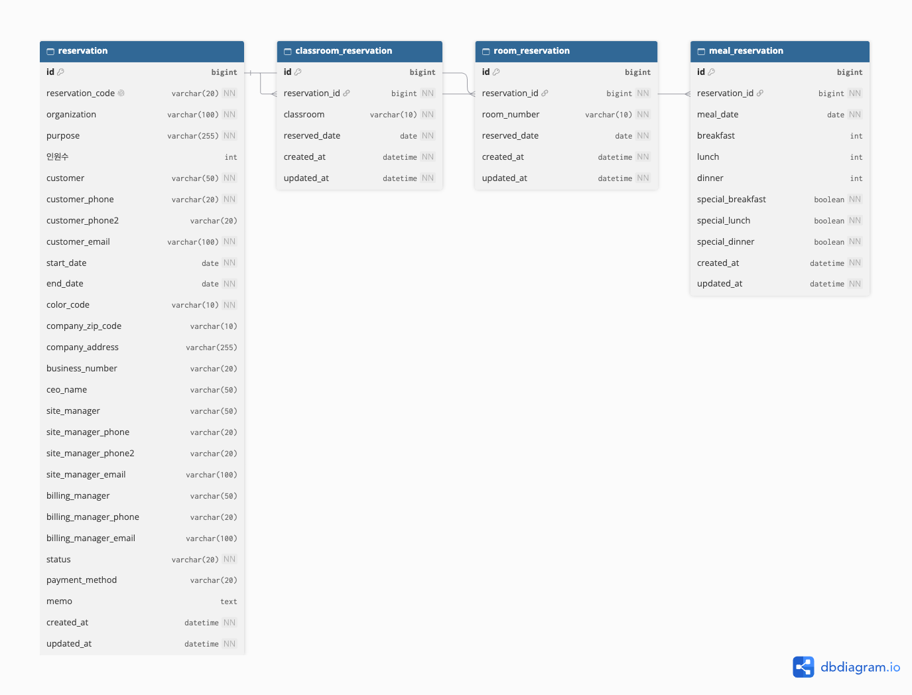
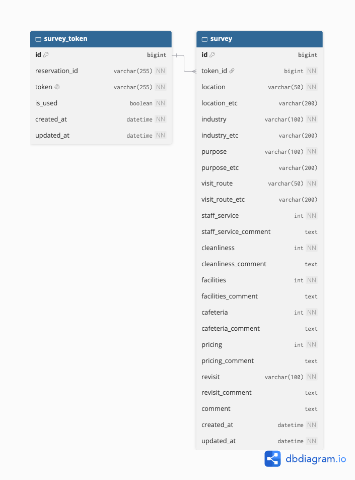

# 🗄️ DB 설계 (ERD)

> 모든 테이블은 `created_at`, `updated_at` 컬럼을 포함합니다 (BaseTimeEntity 상속).

---

## 📋 테이블 목록

| 테이블명              | 설명            |
| --------------------- | --------------- |
| account               | 직원 계정       |
| refresh_token         | 로그인 세션 (기기별 리프레시 토큰) |
| app_setting           | 앱 설정 (KV)    |
| reservation           | 예약 마스터     |
| classroom_reservation | 강의실 예약     |
| room_reservation      | 객실 예약       |
| meal_reservation      | 식사(식수) 예약 |
| survey_token          | 설문 토큰       |
| survey                | 설문 응답       |

---

## 테이블 상세

### 계정 · 설정

#### account (직원 계정)

| 컬럼명        | 타입         | 필수 | 설명                   |
| ------------- | ------------ | ---- | ---------------------- |
| id            | BIGINT       | ✅   | PK, AUTO_INCREMENT     |
| user_id       | VARCHAR(50)  | ✅   | 로그인 아이디 (UNIQUE) |
| username      | VARCHAR(50)  | ✅   | 직원 이름              |
| password      | VARCHAR(255) | ✅   | BCrypt 암호화 비밀번호 |
| role          | VARCHAR(20)  | ✅   | ROLE_ADMIN / ROLE_USER |
| state         | BOOLEAN      | ✅   | 계정 활성화 여부       |
| created_at    | DATETIME     | ✅   | 생성일시               |
| updated_at    | DATETIME     | ✅   | 수정일시               |

---

#### refresh_token (로그인 세션)

> 기기(로그인)마다 1행. 재발급(rotation) 시 `token_hash`, `expires_at` 만 갱신된다. 토큰 원문은 저장하지 않고 해시만 저장한다.

| 컬럼명     | 타입        | 필수 | 설명                             |
| ---------- | ----------- | ---- | -------------------------------- |
| id         | BIGINT      | ✅   | PK, AUTO_INCREMENT               |
| account_id | BIGINT      | ✅   | FK → account.id                  |
| session_id | VARCHAR(36) | ✅   | 세션 식별자 UUID (UNIQUE)        |
| token_hash | VARCHAR(64) | ✅   | 리프레시 토큰 해시               |
| expires_at | DATETIME    | ✅   | 만료일시                         |
| created_at | DATETIME    | ✅   | 생성일시                         |
| updated_at | DATETIME    | ✅   | 수정일시                         |

---

#### app_setting (앱 설정)

| 컬럼명        | 타입         | 필수 | 설명               |
| ------------- | ------------ | ---- | ------------------ |
| id            | BIGINT       | ✅   | PK, AUTO_INCREMENT |
| setting_key   | VARCHAR(100) | ✅   | 설정 키 (UNIQUE)   |
| setting_value | VARCHAR(500) | ✅   | 설정 값            |
| created_at    | DATETIME     | ✅   | 생성일시           |
| updated_at    | DATETIME     | ✅   | 수정일시           |

---

### 예약

#### reservation (예약 마스터)

> 인덱스: `idx_reservation_dates (start_date, end_date)`

| 컬럼명              | 타입         | 필수 | 설명                                         |
| ------------------- | ------------ | ---- | -------------------------------------------- |
| id                  | BIGINT       | ✅   | PK, AUTO_INCREMENT                           |
| reservation_code    | VARCHAR(20)  | ✅   | 고유 예약 번호 (UNIQUE) ex) RES-20260401-001 |
| organization        | VARCHAR(100) | ✅   | 단체명                                       |
| purpose             | VARCHAR(255) | ✅   | 연수 목적                                    |
| 인원수              | INT          | ❌   | 총 인원 (실제 컬럼명이 한글)                 |
| customer            | VARCHAR(50)  | ✅   | 담당자 이름                                  |
| customer_phone      | VARCHAR(20)  | ✅   | 담당자 연락처                                |
| customer_phone2     | VARCHAR(20)  | ❌   | 담당자 연락처2                               |
| customer_email      | VARCHAR(100) | ✅   | 담당자 이메일                                |
| start_date          | DATE         | ✅   | 시작일                                       |
| end_date            | DATE         | ✅   | 종료일                                       |
| color_code          | VARCHAR(10)  | ✅   | 캘린더 표시 색상 (#FF5733)                   |
| company_zip_code    | VARCHAR(10)  | ❌   | 업체 우편번호                                |
| company_address     | VARCHAR(255) | ❌   | 업체 주소                                    |
| business_number     | VARCHAR(20)  | ❌   | 사업자등록번호                               |
| ceo_name            | VARCHAR(50)  | ❌   | 대표자명                                     |
| site_manager        | VARCHAR(50)  | ❌   | 현장 담당자                                  |
| site_manager_phone  | VARCHAR(20)  | ❌   | 현장 담당자 연락처                           |
| site_manager_phone2 | VARCHAR(20)  | ❌   | 현장 담당자 연락처2                          |
| site_manager_email  | VARCHAR(100) | ❌   | 현장 담당자 이메일                           |
| billing_manager     | VARCHAR(50)  | ❌   | 정산 담당자                                  |
| billing_manager_phone | VARCHAR(20) | ❌  | 정산 담당자 연락처                           |
| billing_manager_email | VARCHAR(100) | ❌  | 정산 담당자 이메일                           |
| status              | VARCHAR(20)  | ✅   | 확정 / 예약 / 문의 / 취소                    |
| payment_method      | VARCHAR(20)  | ❌   | 결제 방법                                    |
| memo                | TEXT         | ❌   | 특이사항                                     |
| created_at          | DATETIME     | ✅   | 생성일시                                     |
| updated_at          | DATETIME     | ✅   | 수정일시                                     |

---

#### classroom_reservation (강의실 예약)

> 예약 1건에 강의실 여러 개 / 날짜별 행 분리 저장

| 컬럼명         | 타입        | 필수 | 설명                |
| -------------- | ----------- | ---- | ------------------- |
| id             | BIGINT      | ✅   | PK, AUTO_INCREMENT  |
| reservation_id | BIGINT      | ✅   | FK → reservation.id |
| classroom      | VARCHAR(10) | ✅   | 강의실 호실         |
| reserved_date  | DATE        | ✅   | 사용 날짜           |
| created_at     | DATETIME    | ✅   | 생성일시            |
| updated_at     | DATETIME    | ✅   | 수정일시            |

##### 강의실 목록 (14개)

| 구분     | 호실 | 수용인원 |
| -------- | ---- | -------- |
| 대강의실 | 105  | 120인    |
| 중강의실 | 201  | 70인     |
| 중강의실 | 203  | 50인     |
| 중강의실 | 204  | 50인     |
| 소강의실 | 101  | 30인     |
| 소강의실 | 103  | 30인     |
| 소강의실 | 202  | 30인     |
| 소강의실 | 102  | 20인     |
| 분임실   | 106  | 12인     |
| 분임실   | 107  | 12인     |
| 분임실   | 205  | 12인     |
| 분임실   | 206  | 12인     |
| 다목적실 | A    | 80인     |
| 다목적실 | B    | 40인     |

---

#### room_reservation (객실 예약)

> 예약 1건에 객실 여러 개 / 날짜별 행 분리 저장

| 컬럼명         | 타입        | 필수 | 설명                |
| -------------- | ----------- | ---- | ------------------- |
| id             | BIGINT      | ✅   | PK, AUTO_INCREMENT  |
| reservation_id | BIGINT      | ✅   | FK → reservation.id |
| room_number    | VARCHAR(10) | ✅   | 객실 호수           |
| reserved_date  | DATE        | ✅   | 숙박 날짜           |
| created_at     | DATETIME    | ✅   | 생성일시            |
| updated_at     | DATETIME    | ✅   | 수정일시            |

##### 객실 목록 (1·2층, 층당 27실 / 총 54실)

| 타입  | 호수 (1층 / 2층 동일 구조)        | 층당 |
| ----- | --------------------------------- | ---- |
| 1인실 | x09, x26                          | 2실  |
| 2인실 | x10, x11, x27                     | 3실  |
| 4인실 | 나머지 (x01~x08, x12~x25)         | 22실 |

> x 는 층 번호 (1층 = 101~127, 2층 = 201~227)

---

#### meal_reservation (식사 예약)

> 날짜별 조/중/석 인원 및 특식 여부 관리

| 컬럼명            | 타입     | 필수 | 설명                            |
| ----------------- | -------- | ---- | ------------------------------- |
| id                | BIGINT   | ✅   | PK, AUTO_INCREMENT              |
| reservation_id    | BIGINT   | ✅   | FK → reservation.id             |
| meal_date         | DATE     | ✅   | 식사 날짜                       |
| breakfast         | INT      | ❌   | 조식 인원                       |
| lunch             | INT      | ❌   | 중식 인원                       |
| dinner            | INT      | ❌   | 석식 인원                       |
| special_breakfast | BOOLEAN  | ✅   | 조식 특식 여부 (default: false) |
| special_lunch     | BOOLEAN  | ✅   | 중식 특식 여부 (default: false) |
| special_dinner    | BOOLEAN  | ✅   | 석식 특식 여부 (default: false) |
| created_at        | DATETIME | ✅   | 생성일시                        |
| updated_at        | DATETIME | ✅   | 수정일시                        |

---

### 설문

#### survey_token (설문 토큰)

| 컬럼명         | 타입         | 필수 | 설명                    |
| -------------- | ------------ | ---- | ----------------------- |
| id             | BIGINT       | ✅   | PK, AUTO_INCREMENT      |
| reservation_id | VARCHAR(255) | ✅   | 연결 예약 ID (문자열, FK 제약 없음) |
| token          | VARCHAR(255) | ✅   | 고유 설문 토큰 (UNIQUE) |
| is_used        | BOOLEAN      | ✅   | 응답 여부               |
| created_at     | DATETIME     | ✅   | 생성일시                |
| updated_at     | DATETIME     | ✅   | 수정일시                |

---

#### survey (설문 응답)

> 항목별 점수는 5=매우만족 / 4=만족 / 3=보통 / 2=불만족 / 1=매우불만족. `*_etc` 는 "기타" 선택 시 직접 입력값, `*_comment` 는 항목별 의견.

| 컬럼명                | 타입         | 필수 | 설명                          |
| --------------------- | ------------ | ---- | ----------------------------- |
| id                    | BIGINT       | ✅   | PK, AUTO_INCREMENT            |
| token_id              | BIGINT       | ✅   | FK → survey_token.id          |
| location              | VARCHAR(50)  | ✅   | 회사(단체) 위치               |
| location_etc          | VARCHAR(200) | ❌   | 위치 기타 입력                |
| industry              | VARCHAR(100) | ✅   | 업태                          |
| industry_etc          | VARCHAR(200) | ❌   | 업태 기타 입력                |
| purpose               | VARCHAR(100) | ✅   | 이용 목적                     |
| purpose_etc           | VARCHAR(200) | ❌   | 이용 목적 기타 입력           |
| visit_route           | VARCHAR(50)  | ✅   | 이용 계기                     |
| visit_route_etc       | VARCHAR(200) | ❌   | 이용 계기 기타 입력           |
| staff_service         | INT          | ✅   | 직원 서비스 점수 (1~5)        |
| staff_service_comment | TEXT         | ❌   | 직원 서비스 의견              |
| cleanliness           | INT          | ✅   | 청결 점수 (1~5)               |
| cleanliness_comment   | TEXT         | ❌   | 청결 의견                     |
| facilities            | INT          | ✅   | 시설 점수 (1~5)               |
| facilities_comment    | TEXT         | ❌   | 시설 의견                     |
| cafeteria             | INT          | ✅   | 식당 점수 (1~5)               |
| cafeteria_comment     | TEXT         | ❌   | 식당 의견                     |
| pricing               | INT          | ✅   | 가격 점수 (1~5)               |
| pricing_comment       | TEXT         | ❌   | 가격 의견                     |
| revisit               | VARCHAR(100) | ✅   | 재방문 의향                   |
| revisit_comment       | TEXT         | ❌   | 재방문 관련 의견              |
| comment               | TEXT         | ❌   | 종합 의견                     |
| created_at            | DATETIME     | ✅   | 응답일시                      |
| updated_at            | DATETIME     | ✅   | 수정일시                      |
